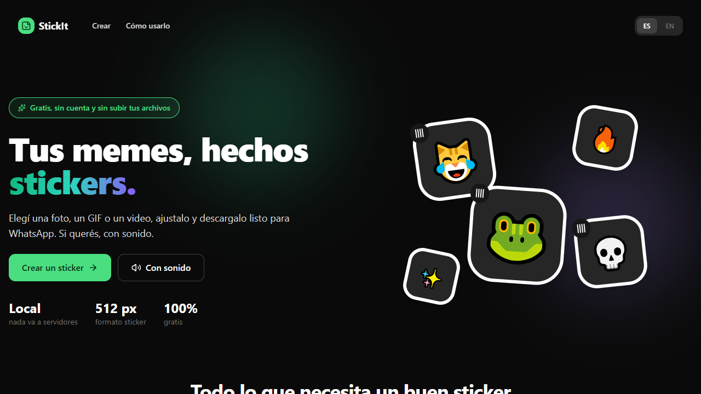

# StickIt

Hacé stickers para WhatsApp a partir de fotos, GIFs y videos, **con o sin sonido**.
Todo se procesa en el navegador: tus archivos no se envían a ningún servidor.

*Make WhatsApp stickers from photos, GIFs and videos, with or without sound. Everything runs in your browser.*



## Qué hace

- **Entrada:** foto, GIF o video (también HEVC, MKV o AVI, que se convierten con ffmpeg). Se puede pegar con Ctrl+V.
- **Edición:** mover, zoom, rotación, fondo blanco, negro o transparente, quitar un color, goma de borrar,
  borde de sticker, texto y emojis. La vista previa se puede abrir a pantalla completa.
- **Sonido:** desde un archivo, el micrófono (con la onda en vivo) o el propio video. Los audios largos se parten en
  varios stickers.
- **Salida:** PNG y WebP de 512×512, MP4, WebM transparente, M4A, y todo junto en ZIP.
- Interfaz en español e inglés, tema claro y oscuro según el sistema.

> StickIt prepara los archivos; el sticker se crea desde WhatsApp. Los stickers con sonido están en beta.
> Ver [cómo pasarlos a WhatsApp](docs/WHATSAPP.md).

## Correrlo

Hace falta Node 20 o más nuevo.

```bash
npm install
npm run dev
```

| Comando | Qué hace |
| --- | --- |
| `npm run dev` | Servidor de desarrollo |
| `npm run build` | Revisa los tipos y compila a `dist/` |
| `npm run preview` | Sirve lo compilado |

## Tecnología

React 18, TypeScript, Vite y Tailwind 3, con componentes de [Blossom UI](https://blossomui.vercel.app/)
(`@blossomui/react`) e iconos de Lucide. El video se codifica con ffmpeg.wasm; el transparente, con los codificadores
del navegador a través de [Mediabunny](https://mediabunny.dev/).

## Documentación

- [Arquitectura y decisiones](docs/ARQUITECTURA.md)
- [WhatsApp: cómo pasar los stickers y qué límites hay](docs/WHATSAPP.md)
- [Despliegue, SEO y GEO](docs/DESPLIEGUE.md)
- [Hallazgos sobre Blossom UI](docs/BLOSSOM-HALLAZGOS.md)

## Navegadores

Se probó en Edge (escritorio y pantallas de celular simuladas). El video transparente necesita WebCodecs: Chrome o Edge
actualizados. iOS no guarda WebM en Fotos.

## Derechos

- El código todavía no tiene una licencia publicada.
- El núcleo de ffmpeg (`@ffmpeg/core`) es **GPL-2.0-or-later** y se distribuye junto con la aplicación compilada.
- Los GIFs de `src/assets/gifs` y `src/assets/sprites` son fragmentos de obras y personas que **pertenecen a sus
  respectivos dueños**. Se usan solo como ejemplo en la portada y no se pueden reutilizar a partir de este repositorio.
  Borrando esas carpetas, la portada muestra emojis (ver [Arquitectura](docs/ARQUITECTURA.md)).

StickIt no está afiliado a WhatsApp ni a Meta.
